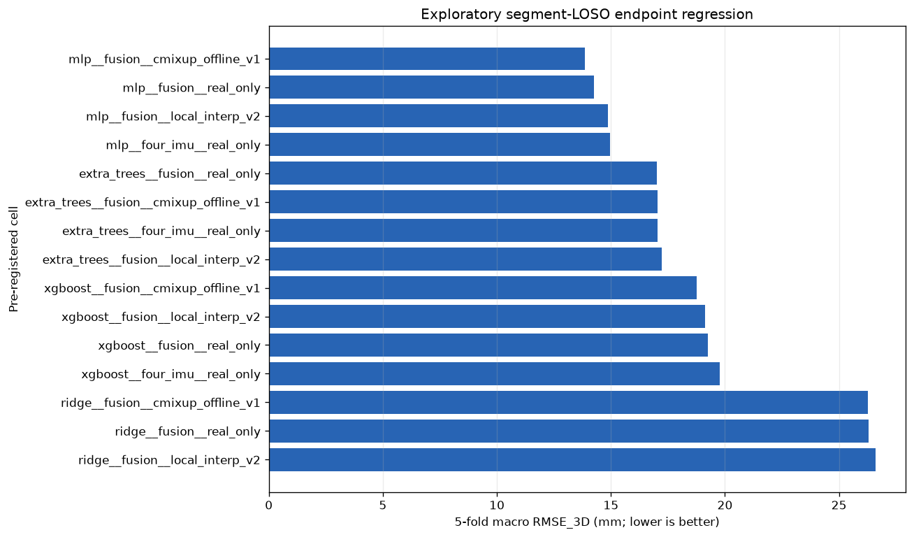

# Endpoint Regression Experiment v1 — Exploratory Report

This report is generated from the locked nested group-CV outputs of
`alphaf.endpoint_regression.experiment.v1`. The prediction target is raw Vive
Tracker XYZ in the `vive_world` frame, in millimetres. This is a static 3-second
trial-summary endpoint-regression/fusion proxy. It is not robot-base/TCP
position, formal ShapeFK, the repository's `IMU-only` condition, a realtime
aggregator, or a control model.

The experiment is exploratory. The implementation and search space were
pre-frozen before this full run, but the same collected dataset had already
been used for feasibility smoke checks. No independent acquisition session is
available, so no confirmatory superiority or control-performance claim is made.

## Release and evaluation contract

- Parent release SHA-256: `94deccb960b0554fb9a683875d36ef5726afc825d4b4ea244a1490f3353b1930`
- Eligible measured trials: `7702`
- Strict-QC measured trials: `7670`
- Primary evaluation: five segment-LOSO outer folds, with four group-held-out
  inner contexts per outer fold.
- Secondary evaluation: five unseen-target outer groups, with four target-group
  inner contexts per outer group.
- Primary selection metric: `RMSE_3D = sqrt(mean(dx^2 + dy^2 + dz^2))`.
- Validation and test predictions contain measured real rows only.

## Primary segment-LOSO results

| cell_id | macro_rmse_3d_mm | macro_p95_3d_error_mm | pooled_median_3d_error_mm | seed_macro_rmse_std_mm |
| --- | --- | --- | --- | --- |
| mlp__fusion__cmixup_offline_v1 | 13.8460 | 20.0508 | 12.2021 | 0.0866 |
| mlp__fusion__real_only | 14.2628 | 21.0190 | 12.9227 | 0.3632 |
| mlp__fusion__local_interp_v2 | 14.8605 | 21.8840 | 13.3297 | 0.5285 |
| mlp__four_imu__real_only | 14.9645 | 21.7271 | 13.3780 | 0.4484 |
| extra_trees__fusion__real_only | 17.0016 | 25.5570 | 14.8675 | 0.0000 |
| extra_trees__fusion__cmixup_offline_v1 | 17.0307 | 25.5355 | 14.9060 | 0.0000 |
| extra_trees__four_imu__real_only | 17.0510 | 25.7271 | 14.7929 | 0.0000 |
| extra_trees__fusion__local_interp_v2 | 17.2404 | 25.9846 | 15.2573 | 0.0000 |
| xgboost__fusion__cmixup_offline_v1 | 18.7597 | 28.2340 | 16.9061 | 0.0000 |
| xgboost__fusion__local_interp_v2 | 19.1396 | 28.4784 | 17.4636 | 0.0000 |
| xgboost__fusion__real_only | 19.2625 | 28.4612 | 17.6916 | 0.0000 |
| xgboost__four_imu__real_only | 19.7737 | 29.7894 | 17.7693 | 0.0000 |

## Secondary unseen-target results

| cell_id | macro_rmse_3d_mm | macro_p95_3d_error_mm | pooled_median_3d_error_mm | seed_macro_rmse_std_mm |
| --- | --- | --- | --- | --- |
| mlp__fusion__local_interp_v2 | 8.8396 | 14.7043 | 4.9982 | 0.3690 |
| mlp__fusion__cmixup_offline_v1 | 9.2078 | 15.9349 | 5.0524 | 0.1778 |
| mlp__fusion__real_only | 9.3298 | 15.7989 | 5.0833 | 0.0793 |
| mlp__four_imu__real_only | 10.8590 | 18.4420 | 5.5989 | 0.3407 |
| xgboost__fusion__local_interp_v2 | 18.9044 | 34.2330 | 13.6808 | 0.0000 |
| xgboost__four_imu__real_only | 23.8420 | 40.8974 | 19.1834 | 0.0000 |
| xgboost__fusion__cmixup_offline_v1 | 25.8195 | 42.9873 | 21.2245 | 0.0000 |
| xgboost__fusion__real_only | 26.0307 | 44.5005 | 20.4471 | 0.0000 |
| ridge__four_imu__real_only | 26.0928 | 47.7178 | 18.7552 | 0.0000 |
| ridge__fusion__cmixup_offline_v1 | 26.5346 | 48.1991 | 18.3579 | 0.0000 |
| ridge__fusion__real_only | 26.7363 | 48.6821 | 18.4388 | 0.0000 |
| ridge__fusion__local_interp_v2 | 27.2824 | 49.1461 | 19.0708 | 0.0000 |

The two evaluation schemes are reported separately; their trials are not
pooled to inflate the effective sample size.

## Augmentation engineering gate

The frozen gate requires a reduction versus the same model's fusion real-only
cell of at least `max(10%, 3 mm)` in macro RMSE_3D, while macro P95 may not
worsen by more than 5%. `0` of `8` model/augmentation
comparisons passed.

| model | recipe | actual_rmse_reduction_mm | required_rmse_reduction_mm | candidate_macro_p95_3d_error_mm | p95_limit_mm | passed |
| --- | --- | --- | --- | --- | --- | --- |
| extra_trees | cmixup_offline_v1 | -0.0290 | 3.0000 | 25.5355 | 26.8348 | False |
| extra_trees | local_interp_v2 | -0.2388 | 3.0000 | 25.9846 | 26.8348 | False |
| mlp | cmixup_offline_v1 | 0.4168 | 3.0000 | 20.0508 | 22.0699 | False |
| mlp | local_interp_v2 | -0.5977 | 3.0000 | 21.8840 | 22.0699 | False |
| ridge | cmixup_offline_v1 | 0.0086 | 3.0000 | 44.5037 | 46.7672 | False |
| ridge | local_interp_v2 | -0.3049 | 3.0000 | 44.6815 | 46.7672 | False |
| xgboost | cmixup_offline_v1 | 0.5028 | 3.0000 | 28.2340 | 29.8843 | False |
| xgboost | local_interp_v2 | 0.1229 | 3.0000 | 28.4784 | 29.8843 | False |

Replay remains a negative exposure-control and cannot be deployed. Local
interpolation and C-Mixup remain separate hypotheses. Multiway bootstrap
intervals are paired by trial and crossed segment/target factors; no p-values
are reported because only five segment groups exist.

## Final all-data model

- Selected cell: `mlp__fusion__real_only`
- Model / view / recipe: `mlp / fusion / real_only`
- Segment-inner aggregate RMSE_3D: `15.8496 mm`
- Selection rule: `no_augmentation_passed_gate_fallback_to_best_primary_real_only`
- Final measured training rows: `7702`
- Final synthetic training rows: `0`
- Independent test score for this all-data refit: **none**

The serialized model carries an exact ordered feature allow-list, train-only
preprocessing, frame/unit metadata, source/config hashes, and a fixed-fixture
prediction hash. The package contains a Python/joblib estimator and must be
loaded only from this trusted, checksum-verified project release; joblib is not
a safe format for untrusted files. The strict-QC refit is a sensitivity
artifact; its reported fit error is resubstitution-only and not an independent
estimate.

## Shortcut diagnostics

| scheme | cell_id | macro_rmse_3d_mm | macro_p95_3d_error_mm |
| --- | --- | --- | --- |
| segment_loso | extra_trees__fusion_mag__real_only | 17.0781 | 25.5890 |
| segment_loso | extra_trees__fusion_planned__real_only | 17.1264 | 25.6258 |
| segment_loso | ridge__fusion_mag__real_only | 18.3282 | 29.5137 |
| segment_loso | ridge__fusion_planned__real_only | 25.1464 | 42.3360 |
| segment_loso | extra_trees__planned_only__real_only | 30.9971 | 51.8521 |
| segment_loso | ridge__planned_only__real_only | 81.8660 | 144.7918 |
| target_group | ridge__fusion_mag__real_only | 18.0604 | 30.9842 |
| target_group | ridge__fusion_planned__real_only | 25.0389 | 43.0972 |
| target_group | extra_trees__fusion_planned__real_only | 38.1616 | 66.7762 |
| target_group | extra_trees__fusion_mag__real_only | 38.2858 | 70.0771 |
| target_group | extra_trees__planned_only__real_only | 55.9695 | 98.3355 |
| target_group | ridge__planned_only__real_only | 86.1159 | 158.0945 |

Planned coordinates and uncalibrated magnetometer channels are diagnostic
shortcuts only. Any apparent gain may encode schedule, environment, or session
identity and is excluded from final deployment selection.

## Reproducibility and limitations

All feature scaling, target centring/scaling, hyperparameter selection,
augmentation parent search, and C-Mixup bandwidth estimation use only the real
train role of the relevant context. Estimator internal thread counts are one;
only context tasks are parallel. Checkpoint reuse is accepted only when the
task, config, split, and release hashes match.

The data cover one static acquisition corpus and raw Vive world coordinates.
An online window aggregator, tracker-to-base/TCP calibration, dynamic motion
validation, external-session validation, and closed-loop safety validation do
not exist in this contract. See `docs/ENDPOINT_REGRESSION_METHODS.md` in the
source repository for the research basis and the boundary between published
methods and project-specific hypotheses.
